# Aladdin Marketplace — Feature Brief & Architecture

**Status:** DRAFT for final Stage 1 review · rev. 5 · 2026-10-11 · **nothing here is implemented** (no code, no migrations, no routes, no accounts created or modified).
**What it is:** a standalone B2C-style direct-price e-commerce feature inside Aladdin, independent of the RFQ/quotation (B2B) flows. It shares only identity, tenancy, i18n and the design system.
**Governance:** [`ADR-0011`](../decisions/ADR-0011-public-b2c-marketplace.md) (Proposed; direction approved by the owner) records the decision.

> One document on purpose. §0 decision log · §1–10 the proposal · §11 stage plan changes · §12 what is still open.

---

## 0. Decision log (approved by the owner)

| ID | Decision | Effect on design |
|---|---|---|
| **DL-01** Guest cart | Browser-based cart before auth. Browse/add without signing in; opening the cart requires Sign In/Up; product ids, variant ids, quantities preserved; **merge** into the authenticated cart after auth; prices/stock/promotions re-validated server-side; client prices never trusted; duplicates, invalid variants, expired offers handled | §8 Cart |
| **DL-02** Sellers | Eligible **Showrooms only** in V1; architecture extensible to Suppliers/Importers/others; **selling permission separate from organization identity**; all approved account types and Guests browse; no change to existing showroom accounts/permissions | §9 seller model |
| **DL-03** Payments | **Online + COD** in V1; order status and payment status **independent**; COD never auto-paid, confirmed only after real collection; COD availability by delivery area / seller config / order value; cancellations, refused deliveries, reservations, refunds modeled; online confirmation server-side + idempotent; provider = Kashier (DL-14) | §8 Orders & payments |
| **DL-04** Taxonomy | **3 categories**, database-driven (not enum); Category / Product Type / Attribute / Variant stay separate | §3 |
| **DL-05** besttrade | Rollout closed by default. First seller = a showroom **besttrade** whose account **does not exist yet** and will be created; other showrooms stay closed until enabled | §9 |
| **DL-06 = D-00** ADR | An official ADR allows an e-commerce system independent of the existing B2B. **ADR-0011 drafted** (Proposed) | §2 |
| **DL-07 = D-17** Buyers | **End Consumer, Supplier, Contractor, Engineer, Craftsman (Installer)** may buy. **Guest must register before opening the cart and completing purchase** | §9 buyer eligibility, §10 |
| **DL-08 = D-18** Delivery & collection | The **showroom** is responsible for delivery and cash collection, directly or via a shipping company. **Aladdin only records and tracks** orders and collection in V1 | §8 |
| **DL-09 = D-19** COD fraud | Protection against fake orders **without arbitrary numeric limits**; the showroom can **review and confirm** the order | §8 COD confirmation |
| **DL-10 = D-20** Launch | **Feature flag, closed in Production** until products, prices, stock and checkout are ready | §10 |
| **DL-11 = D-21** Seller activation | **DB-only controlled activation** for the first showroom, temporarily. **No change to the showroom account or its admin before Stage 6** | §9, §11 |
| **DL-12 = D-22** Delivery / Pickup | Buyer chooses **"Delivery to address"** or **"Pickup from showroom"**. Showroom sets delivery fee per zone **in the future**; the fee is a **separate line** in the order summary and part of the total | §8 |
| **DL-13 = D-23** Showroom isolation | Showroom account work is deferred to the **last functional stage**: no change to showroom dashboard, pages, permissions or current onboarding in early stages | §9, §11 |
| **DL-14 = D-05** Provider | Payment gateway = **Kashier**. **Another engineer is already integrating Kashier into Aladdin.** The Marketplace does **not** build, duplicate, replace or modify that work; it consumes it through a stable contract | §8 Payment architecture |
| **DL-15** Online collection | Customers pay online through Kashier; **Aladdin is the intended recipient of online settlements** and later **reconciles and settles eligible seller/showroom balances**. Seller settlement records, commissions, refunds, reconciliation and audit trails are required. **Merchant-of-record status is not assumed**; contractual, tax and regulatory dependencies are documented. **COD stays seller-collected (D-18)** and is never mixed with online settlement | §8 Seller settlement |
| **DL-16 = D-15** VAT | All prices are displayed **exclusive of VAT and applicable taxes**, labelled as such; taxes are **separate line items** in cart and checkout; delivery fee shown separately; the final payable total is shown before confirmation; subtotal, discounts, shipping, tax components and total are stored separately; **tax-rate and tax-amount snapshots** on order items; **no hardcoded universal VAT rate** (treatment per product/service under an approved tax policy); delivery-fee tax determined separately; refunds/partial cancellations adjust tax; invoice/receipt issuer and tax remitter documented before launch; all computed server-side | §8 Tax & totals |
| **DL-18 = D-07** Dynamic schema | Draft V1 lists per type (materials, patterns, textures, finishes, colors) are **editable data**, not code. The **Dynamic Product Schema Builder** is part of the architecture: Aladdin Admin manages categories, types, fields, options, filters and variant axes, and forms are generated from the schema. Measurements are numeric (canonical mm) and are **not** the unit of sale. **Sheeboard** stays a type with the actual material mandatory. Variants: up to 3 axes in the V1 UI (not a DB constraint); each real combination has its own SKU/price/stock/availability. Showrooms cannot change the global schema. No showroom / B2B / Kashier code is touched | §3 |
| **DL-17 = D-23b** Conflict prevention | Two areas are owned by other engineers — **Showroom account development** and the **Kashier integration**. They are **not modified** in current stages; Marketplace stays isolated and defines **stable integration contracts** instead of competing functionality; integration is deferred until those engineers' work is reviewed and coordinated | §8, §11 |

---

## 1. The feature in one page

**Journey:** Marketplace → Product list → Product details → Add to cart → Sign in (only when opening the cart) → Cart → Checkout (delivery or pickup, online or COD) → Confirmation → Order tracking.

| | |
|---|---|
| Who browses | Guests + every approved role |
| Who buys | End Consumer · Supplier · Contractor · Engineer · Craftsman — after registering |
| Who sells | Admin-enabled Showrooms only; initially **besttrade** alone |
| What is sold | Physical products at direct EGP prices. **No RFQ/quotation/negotiation.** Installer services are not in the cart |
| First products | Wallpaper `ورق حائط` · Wood Alternative `بديل خشب` · Marble Alternative `بديل رخام` · Sheeboard `شيبورد` · Cornices `كرانيش` · Corner Trims `زوايا` |
| Shop by | Product · Finishing type (materials + related installers) |
| Fulfilment | Delivery to address or pickup from showroom; showroom delivers/collects |
| Payment | Online through **Kashier** (collected by Aladdin, later settled to showrooms) or COD (collected by the showroom), when eligible. Prices shown **exclusive of tax**; taxes are separate lines |
| Offers | Regular, flash (real server-side expiry), bundles later |
| Release | Behind a feature flag, closed on Production |

---

## 2. Separation from the existing system

Verified in the repo:

- B2B `public.products` has no price, is RFQ-oriented, and its enums (`product_category`, `product_unit`) don't fit consumers (no *board* / *عود*).
- B2B `public.orders` **cannot** represent a consumer purchase: `quotation_id NOT NULL`, `rfq_id NOT NULL`, `requester_org_id ≠ supplier_org_id`.

**Decision:** Marketplace has its **own tables, enums, capabilities, RPCs and routes**, prefixed `marketplace_`. No foreign key between Marketplace and `products / rfqs / quotations / orders / order_items / projects`. B2B is untouched.

**Reused:** `organizations` (+ `branches`), `users`, `public.trades`, `app.has_capability`, `audit_log`, i18n catalogs, "The Aperture" design system, storage conventions, place catalogue.

**Existing docs that conflict (resolved by ADR-0011):** `PRODUCT_DIRECTION_GUIDE.md` (L24, L245–247, L287, L364), root `AGENTS.md` (L63), `CLAUDE.md`, and `mvp-scope.md` ("no checkout"). ADR-0011 is drafted; the change-history entry in the product guide and the other memory-file updates are **listed but not yet applied** (they edit existing files — awaiting your go).

---

## 3. Product taxonomy and Dynamic Product Schema (DL-04, DL-18)

```
Category (3)  →  Product Type (6)  →  Product (per seller)  →  Variant / SKU (price · stock · unit)
                      ↘ Field definitions (the product schema, managed by Aladdin Admin)
```

| Category (key) | AR | Product types (keys) |
|---|---|---|
| `wall_coverings` Wall Coverings & Decorative Panels | ديكورات وتكسية الحوائط | `wallpaper`, `wood_alternative`, `marble_alternative`, `sheeboard` |
| `cornices_mouldings` Cornices & Mouldings | الكرانيش والحليات | `cornice` |
| `finishing_accessories` Finishing Accessories | إكسسوارات التشطيب | `corner_trim` |

- Four separate layers, each with its own table and owner: **Category** (navigation) · **Product Type** (owns its schema) · **Field** (property definition + options) · **Variant** (sellable SKU).
- Categories and types are **data, never enums**, and the **Admin can add new categories and types** (e.g. paints) without a deployment.
- Labels of admin-managed rows (categories, types, fields, options, colors) are **stored in the database** (`name_ar` / `name_en`) because Admin edits them at runtime; the i18n catalog is used only for fixed UI chrome.
- No subcategory level now; `parent_id` can be added later without data migration.

### 3.1 Dynamic Product Schema Builder (core part of the architecture)

**Goal:** the "add product" form for a type is **generated from that type's schema** — no hand-written form per type. Adding "Paints" later = Admin creates the type and its fields; length/width/thickness simply are not part of it.

**Admin can** (Aladdin Admin; an independent Marketplace Admin UI, built later — not in the showroom dashboard):
1. add a category; 2. add a product type; 3. add custom fields to a type; 4. edit field names in AR/EN; 5. choose the field type — text · number · single-choice · multi-choice · yes/no · **measurement with unit**; 6. mark a field required or optional **on publish**; 7. mark it filterable; 8. mark it usable as a **variant axis**; 9. add, edit or disable options (materials, colors, patterns, textures, finishes); 10. reorder fields; 11. hide/disable a field for a type; 12. **preview the generated form before publishing** a schema change.

**Showroom** fills the fields the Admin defined and manages price, stock and offers (Stage 6). **A showroom can never change the global schema.**

**Guardrails**
| Rule | Why |
|---|---|
| Commerce **system fields** — product identity (name, slug, type), SKU, price, sale unit, stock/availability — are not part of the editable schema and cannot be removed | the platform stays sellable whatever the schema becomes |
| Removing/hiding a field **never deletes stored values**; fields and options are **disabled / deprecated / archived**, with a change log | old products and orders keep their data |
| A change to a required field must not break published products or past orders: it applies to **new publications**; existing published products are flagged "needs update", not unpublished | stability |
| Orders and cart lines **snapshot** the field values and labels shown at purchase | history is immutable |
| A field can be **filterable only if its type supports correct filtering** (single/multi-choice, yes/no, number, measurement). Free text is searchable, never filterable | valid facets |
| Schema changes go through **draft → preview → publish** with a version number and actor | audit, safe rollout |

### 3.2 Schema entities (design proposal — not created)
| Entity | Purpose |
|---|---|
| `marketplace_fields` | field dictionary: `key`, `value_type` (`text`/`number`/`option`/`multi_option`/`boolean`/`measurement`/`color`), `measurement_dimension` (length/area/volume/mass/none) with a **canonical stored unit** (e.g. mm), `name_ar`, `name_en`, `status` (active/disabled/deprecated), `is_system` |
| `marketplace_field_options` | options of option-type fields: `key`, `name_ar`, `name_en`, `sort_order`, `status`, optional `meta` (e.g. swatch) |
| `marketplace_colors` | the **shared Color Catalog** (all types): `key`, `name_ar`, `name_en`, `hex`, `family`, `status`; supports primary + secondary color per variant and a vendor/model color code |
| `marketplace_type_fields` | which fields a type uses and how: `scope` (product / variant), `required_on_publish`, `is_filterable`, `is_searchable`, `is_variant_axis`, `display_order`, `group`, `status` |
| `marketplace_schema_versions` | per type: `version`, `status` draft/published/archived, `published_by/at`, JSON snapshot used for the form preview and for audit |
| `marketplace_schema_changes` | append-only change log (who changed what, when, before/after) |
| `marketplace_product_values` / `marketplace_variant_values` | the values: exactly one of `option_id`, `color_id`, `number_value`, `text_value`, `bool_value` per row (multi-choice = several rows); **measurements stored in the canonical unit** (mm) and displayed/entered in cm or m per field display setting |

**The five concepts are kept separate** (D-07): **Material**, **Color**, **Pattern**, **Texture**, **Surface Finish** are five independent fields — never merged into one "attribute".

### 3.3 Measurements, units of sale, variants
- **Measurements** are numeric fields in one internal unit (mm), shown/entered in cm or m; common sizes may be offered as quick-picks but a new size is never blocked.
- **Dimensions are not the unit of sale.** A product may be sold per roll, board, bar, piece, linear meter, square meter or pack. Not every type needs length/width/thickness (paints would need container volume and coverage instead).
- **Variants:** the Admin decides, per product type, **which fields may be variant axes**. V1's product form allows **up to 3 axes** (a UI limit in V1, **not** a permanent database constraint). Only combinations the showroom actually sells are created (no automatic cartesian product). Every real combination has its **own SKU, price, stock and availability**.

### 3.4 Draft V1 schema per type (editable by Admin — **not** a claim that BestTrade stocks every option)

| Type | Material | Design / pattern | Texture | Finish | Other fields (P = product, V = variant) | Typical variant axes |
|---|---|---|---|---|---|---|
| Wallpaper | Paper · Vinyl · Non-woven · Fabric · Vinyl-coated | plain · geometric · floral · classic · marble · wood · 3D · kids | smooth · grainy · embossed · fabric | — | washable (P) · roll width (V) · roll length (V) · pattern repeat (P) | color/design · roll size · finish (when SKU differs) |
| Wood alternative | PVC · WPC · MDF · PS *(per actual spec)* | longitudinal slats · fluted · wood grain · plain · geometric | smooth · wood · grainy · embossed | matt · gloss · semi-gloss | length · width · thickness (V) · moisture resistance (P) | color · size · thickness |
| Marble alternative | PVC · SPC · verified composites | gold veins · grey veins · black veins · natural-stone look · plain | smooth · stone · grainy | matt · gloss | length · width · thickness (V) | color/design · size · finish |
| Sheeboard | **must be set per actual product** — candidates: Particleboard · MDF · PVC Foam Board · WPC · Other Verified Material | wood · plain · marble · geometric | smooth · wood · grainy | matt · gloss | length · width · thickness (V) | design · size · thickness |
| Cornices | PU · PS · Gypsum · PVC | plain · classic · modern · ornate | smooth · embossed · carved | — | bar length (V) · profile width/height (V) · paintable (P) · LED-compatible (P) | model · profile size · length |
| Corner trims | Aluminum · PVC · Stainless steel · WPC | plain · metallic · wood | — | matt · gloss · polished | kind: internal / external / end (P) · length (V) · profile size (V) · compatible panel types (P) | color · profile size · length |

**Shared Color Catalog (Draft V1):** white, off-white, cream, beige · light grey, dark grey, black · light brown, dark brown, walnut, oak · gold, silver, bronze, copper · green, blue, pink, other · multi-colour. Each variant may carry a primary and secondary color and a vendor/model color code.

**Sheeboard rule (closed):** "Sheeboard" stays a separate product type, but the **actual material must be specified and documented to publish**; the system never pre-selects PVC, MDF or any material because the type was chosen. "Other Verified Material" requires a verification note. Candidates are different technical materials and are not all "chipboard".

### 3.5 Selling units
| Unit | AR | Typical use |
|---|---|---|
| roll | رول | wallpaper |
| board | لوح | wood/marble alt., sheeboard |
| piece | قطعة | cornice, trims |
| bar | عود | cornice, trims |
| linear meter | متر طولي | cornice, trims |
| square meter | متر مربع | panels |
| pack | عبوة | any |

Price is **per sale unit**; stock is counted **in the same unit**; only seller-declared numbers (`coverage_per_unit`, `pack_size`) bridge units; `min_order_qty` / `qty_step` are validated in the cart. The platform never invents conversions. Allowed units per type are themselves Admin-managed data (D-08).

---

## 5. Filters and search

- **Global:** search · category · type · price range · brand · seller · availability · on-offer/flash · featured · fulfilment (delivery/pickup, later) · sort (relevance, newest, price ↑↓; **best-selling only after real paid-order data**; no "popular" until defined).
- **Dynamic:** generated from the **type's schema** (§3): every field marked filterable renders the widget that matches its type — choice/multi-choice (checkboxes), color (swatches from the shared Color Catalog), yes/no, number and measurement (range). A field is filterable **only if its type supports correct filtering**; free text is searchable but never filterable. Adding or disabling a filter is an Admin schema change, not a code change.
- **URL = state:** `/marketplace/products?type=wood_alternative&q=oak&price=1000-5000&a.color=oak,walnut&a.thickness_mm=8-12&avail=in_stock&sort=price_asc&cursor=…`
- **Semantics:** AND between groups, OR within multi-select, ranges inclusive; variant-level filters must match **one and the same variant**; card price = lowest effective price among matching purchasable variants ("from …").
- **Engine:** Postgres only — Arabic-normalized text + `tsvector (simple)` + `pg_trgm`, keyset pagination, one RPC per page. A facet projection table only if EAV proves slow.

---

## 6. Finishing discovery (Path B)

`Finishing Group → Finishing Task → Product Types (primary / complementary / optional) → Installer Trade (existing)`

| Group | Trades (all 14 preserved) |
|---|---|
| A. Wall Coverings & Cladding | `wallpaper_installation`, `wood_alternative_installation`, `marble_alternative_installation` |
| B. Ceilings & Gypsum | `gypsum_board_installation`, `plastering_and_gypsum`, `foutek_installation` |
| C. Painting & Decorative Finishes | `painting`, `spray_paint_and_foundation`, `decorative_paints` |
| D. Flooring | `vinyl_flooring_installation`, `hdf_flooring_installation`, `epoxy_flooring` |
| E. Doors & Wood Finishing | `door_installation`, `astarji` |

| Task | Primary | Complementary | Status |
|---|---|---|---|
| wallpaper_installation | wallpaper | – | live |
| wood_alternative_installation | wood_alternative | corner_trim (compatible only) | live |
| marble_alternative_installation | marble_alternative | corner_trim (compatible only) | live |
| foutek_installation | – | cornice (**explicit per-product compatibility**) | live |
| gypsum_board / plastering_and_gypsum | – | cornice (confirmation, D-10) | pending |
| *(sheeboard)* | sheeboard | corner_trim | **no matching trade — D-11** |
| painting, flooring, doors, astarji… | – | – | hidden until they have products |

Reuse `public.trades` (no duplicate tables; no change to registration/onboarding); one product serves many tasks without duplication; a task is hidden until it has published products; compatibility is explicit; installers appear as links to the existing installer journey, never as cart items. Trades are a discovery signal, never authorization (existing rule O5).

---

## 7. Data model (PROPOSED — not implemented)

```mermaid
erDiagram
  ORGANIZATIONS ||--o| MARKETPLACE_SELLER_ACCOUNTS : "enrolled as"
  MARKETPLACE_SELLER_ELIGIBLE_ORG_TYPES ||--o{ MARKETPLACE_SELLER_ACCOUNTS : "type allowed by"
  MARKETPLACE_SELLER_ACCOUNTS ||--o{ MARKETPLACE_PRODUCTS : sells
  MARKETPLACE_SELLER_ACCOUNTS ||--o{ MARKETPLACE_DELIVERY_ZONES : "delivers to"
  MARKETPLACE_SELLER_ACCOUNTS ||--o{ MARKETPLACE_PICKUP_POINTS : "pickup at"
  MARKETPLACE_BUYER_ELIGIBLE_ACCOUNT_TYPES ||--o{ MARKETPLACE_CHECKOUTS : "type allowed by"
  MARKETPLACE_CATEGORIES ||--o{ MARKETPLACE_PRODUCT_TYPES : groups
  MARKETPLACE_PRODUCT_TYPES ||--o{ MARKETPLACE_PRODUCTS : classifies
  MARKETPLACE_PRODUCT_TYPES ||--o{ MARKETPLACE_TYPE_FIELDS : "schema of"
  MARKETPLACE_FIELDS ||--o{ MARKETPLACE_TYPE_FIELDS : used_by
  MARKETPLACE_FIELDS ||--o{ MARKETPLACE_FIELD_OPTIONS : vocabulary
  MARKETPLACE_PRODUCT_TYPES ||--o{ MARKETPLACE_SCHEMA_VERSIONS : versions
  MARKETPLACE_SCHEMA_VERSIONS ||--o{ MARKETPLACE_SCHEMA_CHANGES : logged
  MARKETPLACE_PRODUCTS ||--o{ MARKETPLACE_PRODUCT_VALUES : described_by
  MARKETPLACE_VARIANTS ||--o{ MARKETPLACE_VARIANT_VALUES : differs_by
  MARKETPLACE_FIELDS ||--o{ MARKETPLACE_PRODUCT_VALUES : of
  MARKETPLACE_FIELDS ||--o{ MARKETPLACE_VARIANT_VALUES : of
  MARKETPLACE_COLORS ||--o{ MARKETPLACE_VARIANT_VALUES : "primary / secondary"
  MARKETPLACE_PRODUCTS ||--|{ MARKETPLACE_VARIANTS : sold_as
  MARKETPLACE_PRODUCTS ||--o{ MARKETPLACE_PRODUCT_IMAGES : has
  MARKETPLACE_UNITS ||--o{ MARKETPLACE_VARIANTS : priced_per
  MARKETPLACE_VARIANTS ||--|| MARKETPLACE_INVENTORY : stock
  MARKETPLACE_VARIANTS ||--o{ MARKETPLACE_STOCK_MOVEMENTS : ledger
  MARKETPLACE_VARIANTS ||--o{ MARKETPLACE_PRICE_HISTORY : history
  MARKETPLACE_VARIANTS ||--o{ MARKETPLACE_INVENTORY_RESERVATIONS : held
  MARKETPLACE_OFFERS ||--|{ MARKETPLACE_OFFER_ITEMS : contains
  MARKETPLACE_VARIANTS ||--o{ MARKETPLACE_OFFER_ITEMS : discounted
  USERS ||--o{ MARKETPLACE_CARTS : owns
  MARKETPLACE_CARTS ||--o{ MARKETPLACE_CART_ITEMS : holds
  USERS ||--o{ MARKETPLACE_ADDRESSES : saves
  USERS ||--o{ MARKETPLACE_CHECKOUTS : places
  MARKETPLACE_CHECKOUTS ||--|{ MARKETPLACE_ORDERS : split_per_seller
  MARKETPLACE_SELLER_ACCOUNTS ||--o{ MARKETPLACE_ORDERS : fulfils
  MARKETPLACE_ORDERS ||--|{ MARKETPLACE_ORDER_ITEMS : snapshots
  MARKETPLACE_ORDERS ||--o{ MARKETPLACE_PAYMENTS : "settled by"
  MARKETPLACE_PAYMENTS ||--o{ MARKETPLACE_PAYMENT_EVENTS : events
  MARKETPLACE_PAYMENTS ||--o{ MARKETPLACE_REFUNDS : refunded_by
  MARKETPLACE_ORDER_ITEMS ||--o{ MARKETPLACE_ORDER_ITEM_TAXES : tax_snapshot
  MARKETPLACE_TAX_CODES ||--o{ MARKETPLACE_TAX_RATES : effective_rates
  MARKETPLACE_SELLER_ACCOUNTS ||--o{ MARKETPLACE_SELLER_LEDGER : accrues
  MARKETPLACE_SETTLEMENT_BATCHES ||--o{ MARKETPLACE_SELLER_LEDGER : settles
  MARKETPLACE_ORDERS ||--o{ MARKETPLACE_SELLER_LEDGER : sources
  MARKETPLACE_PAYMENTS ||--o{ MARKETPLACE_RECONCILIATION_ITEMS : matched_in
  MARKETPLACE_ORDERS ||--o{ MARKETPLACE_ORDER_STATUS_EVENTS : timeline
  TRADES ||--o{ MARKETPLACE_FINISHING_TASKS : reused
```



New in rev. 5: the **Dynamic Product Schema** tables (`fields`, `field_options`, `colors`, `type_fields`, `schema_versions`, `schema_changes`, `product_values`, `variant_values`) replace the earlier fixed attribute tables — see §3.2. **The draft migration written earlier (`catalog foundation`) is NOT approved and has been moved out of `supabase/migrations/`.**

New in rev. 3: `settings` (feature flags, DB-enforced), `buyer_eligible_account_types`, `pickup_points`, delivery/pickup fields on orders, `order_status_events`.

| Group | Tables / key columns |
|---|---|
| Rollout | `marketplace_settings` (singleton): `browse_enabled`, `checkout_enabled` — enforced inside RPCs |
| Sellers | `seller_eligible_org_types(org_type)` — V1 row: `showroom_dealer` · `seller_accounts(organization_id PK, status approved/suspended/revoked, cod_enabled, activated_by, activated_at, reason, version)` — **no row = closed** · `delivery_zones(seller, place_id, delivery_fee, cod_allowed, is_active)` — placeholder, fee entry arrives later (DL-12) · `pickup_points(seller, branch_id/address, hours, is_active)` |
| Buyers | `buyer_eligible_account_types(account_type)` — V1: `end_consumer, supplier, contractor, engineer, installer_technician` |
| Orders | `checkouts(buyer_user_id, buyer_org_id nullable (reserved, D-02), totals, idempotency key)` → `orders(checkout_id, seller_org_id, fulfilment_type delivery/pickup, payment_method online/cod, order_status, payment_status, subtotal_ex_tax, discount_total, delivery_fee, delivery_fee_tax, tax_total, other_charges, total, address_snapshot jsonb, pickup_snapshot jsonb, carrier_name?, tracking_ref?, seller_confirmed_at/by, collected_at/by/amount)` → `order_items` snapshots · `order_status_events` append-only |
| Payments | `payments(order_id, method online/cod, provider?, provider_ref?, amount, currency, status, idempotency_key)` · `payment_events` append-only, unique `(provider, provider_event_id)`, raw payload service-only · `refunds(payment_id, order_item scope, amount, tax_adjustment, reason, status, idempotency_key, provider_ref?)` |
| Tax | `tax_codes(key, description, is_active)` assigned to product types/variants and to delivery fees · `tax_rates(tax_code_id, rate, effective_from/to, approved_by, policy_ref)` — **no row is seeded with an assumed rate** · `order_item_taxes(order_item_id, tax_code, rate_snapshot, base_amount, tax_amount)` immutable snapshot |
| Settlement (online only) | `seller_ledger` append-only entries per seller/order (`order_paid`, `commission`, `refund`, `tax_collected?`, `adjustment`, `payout`; `pending → available → settled`) · `settlement_batches(seller, period, totals, status, payout_ref)` · `reconciliation_items(payment_id, provider_report_ref, status matched/unmatched/disputed, diff)` — **COD orders never enter the settlement ledger as money received** |

Key choices (unchanged): price on the variant (`numeric(14,2)`, EGP-only check) + append-only history; offers overlay and never overwrite price; inventory per seller/variant (`on_hand`, `reserved`, `available`) with an append-only ledger; same-org integrity via composite FKs; **all writes through SECURITY DEFINER RPCs**; full order snapshots. Conventions follow `docs/database/naming-conventions.md` and ADR-0002.

---

## 8. Commerce rules

### Cart (DL-01)
> **Implemented 2026-10-19 (local, unpushed): the guest cart page, per-showroom delivery prices by governorate/area, pickup switch and a total of products + delivery (no tax line) — see [`cart-and-delivery.md`](cart-and-delivery.md).** The built cart differs from the bullets below in two stated ways: it opens without sign-in, and it stores `{slug, sku, qty}` because the public API exposes no variant ids. Checkout is not built.
- Guest cart in local storage: `{variantId, qty}[]`, schema-versioned, **no prices**, no anonymous server writes.
- Opening the cart requires sign-in/sign-up; the local cart is untouched during sign-in/OTP (same origin).
- **Merge RPC** after auth: sums duplicate variants (clamped to `qty_step`/limits/stock), drops unpublished or invalid variants, re-prices expired offers, returns a **merge report** (kept / adjusted / removed + reason). Local copy is cleared only after a successful merge.
- Server cart stores no price. Price/stock/offer are re-derived on every render and authoritatively when **checkout starts**; a difference returns `price_changed` / `unavailable` that the user must confirm.
- Only accounts of an **eligible buyer account type** may merge/checkout (§9); others see a clear "not available for your account type" state.

### Offers
- `regular`, `flash` (`bundle` later). Window + status; expiry decided server-side; countdown cosmetic.
- **One effective offer per variant**; flash outranks regular; no stacking; enforced at write time (exclusion constraint).
- `reference_price` snapshot; struck-through price only when genuine. Per-customer and total caps consumed atomically.

### Fulfilment — delivery or pickup (DL-12)
- Buyer chooses **Delivery to address** or **Pickup from showroom** per seller order.
- **Delivery:** requires an address; fee comes from the seller's zone for that address; if the seller has no matching zone, delivery is **not offered** (pickup only) — no invented default fee.
- **Pickup:** requires a seller pickup point; fee 0.
- **Order summary lines (DL-16):** `product subtotal (excl. tax)` · `discounts` · `taxes` (separate line items) · **`delivery fee` (separate line)** · `other approved charges` · **`final payable total`** — shown **before** the buyer confirms. The fee and its tax treatment are snapshotted on the order.
- The showroom is responsible for delivering (own fleet or a shipping company). The order may carry a free-text `carrier_name` / `tracking_ref`; **no carrier integration** in V1.

### Orders & payments — two independent state machines (DL-03, DL-08, DL-09)

`payment_method`: `online` | `cod` (for pickup, COD means pay at handover).

**Order status** (fulfilment)
```
pending_confirmation → confirmed → processing ─┬─► shipped (delivery) ─► delivered
                                                └─► ready_for_pickup (pickup) ─► delivered (handed over)
any pre-shipping state → cancelled
shipped / ready_for_pickup → delivery_failed (refused / unreachable / pickup no-show) → returned
```
| Status | Meaning |
|---|---|
| `pending_confirmation` | placed. Online: awaiting verified payment. **COD: awaiting showroom review/confirmation** |
| `confirmed` | online payment verified (and/or seller accepted) · COD: showroom confirmed |
| `processing` | preparing |
| `shipped` / `ready_for_pickup` | handed to delivery / waiting at showroom |
| `delivered` | received by the buyer (delivery or pickup handover) |
| `cancelled` | by buyer (before shipping), showroom, or system |
| `delivery_failed` | refused / unreachable / no-show (reason recorded) |
| `returned` | goods back with seller |

**Payment status** (meaning depends on `payment_method`)
| Status | Online | COD |
|---|---|---|
| `pending` | awaiting provider confirmation | awaiting collection (**default; never auto-paid**) |
| `paid` | verified server-side | n/a |
| `collected` | n/a | cash actually collected |
| `not_collected` | n/a | refused / failed / cancelled |
| `failed` / `cancelled` | declined / abandoned | n/a |
| `refund_pending` → `refunded` / `partially_refunded` | provider refund | manual refund recorded |

Rules:
1. **Online:** paid only after verified signed webhook / provider fetch; unique `(provider, provider_event_id)`; idempotency keys on creation and processing; the success redirect is read-only.
2. **COD:** `payment_status = pending` until `collected`. `collected` requires an explicit RPC by an authorized seller actor, **only when the order is `delivered`**, and records who/when/amount in the audit trail.
3. **Independence:** no transition on one machine silently changes the other, except the documented couplings: online `paid` → order may become `confirmed`; COD + `cancelled`/`delivery_failed` → `not_collected`.
4. **COD fraud protection (DL-09):** **no platform-imposed numeric limits.** Instead:
   - every COD order enters `pending_confirmation` and is **reviewed and confirmed by the showroom** (or cancelled) before processing;
   - the platform records **objective signals** for the showroom's review (phone verified or not, buyer's history of `delivery_failed` / `not_collected` orders) and shows them as information — it does not auto-reject;
   - any seller-configured limits (e.g. maximum COD order value, `cod_enabled`, zone `cod_allowed`) are **the seller's own settings with no default value**.
5. **COD eligibility:** seller COD enabled **and** zone/pickup point allows COD **and** (if the seller set one) order value within the seller's threshold. Evaluated at checkout creation and re-checked at placement. A mixed cart is COD-eligible only if **every** seller in it qualifies (moot while besttrade is the only seller).
6. **Stock (both methods):** reserve at checkout; reservation is **consumed** (`on_hand` decremented, `sale` movement) when the order reaches `confirmed`; on `cancelled` / `delivery_failed` → `returned` a `return` movement restocks if goods are resellable. Online reservations expire by TTL if payment never arrives; COD reservations are held while awaiting showroom confirmation, with an expiry policy (value → D-24).
7. **Refused/failed COD:** `delivery_failed` → `not_collected` → `returned` (restock movement); no money moved.
8. **Refunds:** online via provider adapter (idempotent); COD only after collection, recorded manually; either creates a payment event and optional stock return.
9. **Two different money flows — never mixed (DL-08, DL-15):**
   - **COD cash** is collected and kept by the **showroom**, which also handles delivery/couriers. Aladdin does not custody it and does not integrate carriers in V1; it records and tracks.
   - **Online payments** are paid through Kashier and **received by Aladdin**, which later reconciles and **settles eligible balances to the showroom** (see *Seller settlement*).

#### Tax & totals (DL-16) — documentation only
1. **Display:** listing and detail prices are **tax-exclusive** and labelled ("السعر غير شامل الضريبة المطبقة" / "Price excludes applicable taxes"). Cart and checkout show taxes as **separate line items**; delivery fee is separate; the **final payable total** is shown before confirmation.
2. **Formula (server-side only):**
   `Final Payable Total = Tax-Exclusive Product Subtotal − Applicable Discounts + Applicable Taxes + Delivery Fees (+ its tax, if applicable) + Any Other Explicitly Approved Charges`.
   One server function computes it; any client-supplied amount is ignored; the same function is re-run at checkout creation and at payment initiation, and the paid amount must equal it.
3. **Storage:** order level — `subtotal_ex_tax`, `discount_total`, `tax_total`, `delivery_fee`, `delivery_fee_tax`, `other_charges`, `total`. Item level — unit price (ex-tax), discount, tax code, **rate snapshot**, **tax amount** (and per-component rows when several taxes apply).
4. **Policy, not constants:** tax treatment is a data-driven `tax_code` per product type/variant (and a separate one for delivery fees) with dated `tax_rates` set by an **approved tax policy**. **No universal rate is hardcoded and none is seeded.** Publishing a product requires an assigned tax code; checkout is blocked if any line lacks one.
5. **Refunds / partial cancellations:** computed from the **item snapshot** (proportional base + proportional tax); delivery fee and its tax follow the delivery policy; the refund record stores the tax adjustment.
6. **Open (documented, not decided here):** rounding rule (line vs order level); whether delivery fee is taxable and at which treatment; who **issues invoices/receipts** and who **remits taxes** (seller vs Aladdin as collector) — must be recorded **before production launch** (D-30).

#### Payment architecture & integration contract (DL-14, DL-17) — interface only, nothing implemented
**State of the repository (verified 2026-10-11):** no Kashier/payment code exists in this worktree, `origin/main` or any remote branch (searched code, docs, branch names and commit history). The other engineer's work is therefore **not inspectable from here** — presumably in progress/unpushed. Nothing in this document depends on or assumes its internals; the boundaries below must be **agreed with that engineer before Stage 5**.

Rules of engagement:
- **No second Kashier integration. No change** to the existing engineer's files, credentials, endpoints or tests. The Marketplace holds **no gateway credentials or signature secrets** and has **no Kashier-specific code**.
- The Marketplace is a **client of a payment contract** (port). The integration owner implements the contract; the Marketplace implements only its side (order/payment state, stock, ledger).

Expected interface (names illustrative; to be agreed):
| # | Operation | Direction | Required behavior |
|---|---|---|---|
| 1 | `create_payment(order_ref, amount, currency=EGP, buyer_ref, return_urls, idempotency_key)` | Marketplace → integration | amount is the **server-computed** total; returns `provider_ref` + the redirect/hosted-session data; same `idempotency_key` returns the same result |
| 2 | **Payment event** (`paid` / `failed` / `cancelled` / `refunded`) | integration → Marketplace | delivered only **after signature verification**; carries `provider`, `provider_event_id`, `provider_ref`, `amount`, `currency`, `status`, timestamps; **at-least-once** delivery |
| 3 | `get_payment_status(provider_ref)` | Marketplace → integration | authoritative server-to-server lookup for the return page and reconciliation |
| 4 | `refund(provider_ref, amount, reason, idempotency_key)` | Marketplace → integration | idempotent; returns `refund_ref` + status; partial refunds supported |
| 5 | `settlement_report(period)` | integration → Marketplace | provider transaction/fee/settlement data used for reconciliation (**availability to be confirmed**) |

Marketplace-side server behavior (to implement in Stage 5 after coordination):
- **Idempotent confirmation:** unique `(provider, provider_event_id)`; replays are no-ops; the transition `payment pending → paid`, order `pending_confirmation → confirmed`, stock reservation **consumed** and the seller-ledger `order_paid` entry happen in **one transaction**.
- **Validation:** reject events whose amount/currency ≠ the order's server total, whose `provider_ref` is unknown, or whose order is already terminal; unknown/late events are stored for review, not applied.
- **Never trust the browser:** the return/redirect page only displays state read from the server.
- **Out-of-order and duplicate events** (e.g. `refunded` before `paid`) are held and re-evaluated; the state machine rejects illegal transitions.
- **Failure/expiry:** a payment not confirmed within the reservation TTL releases stock; a late `paid` after expiry is flagged for manual handling (refund or re-allocate) — never silently applied.
- **Webhook endpoint ownership:** whether the Marketplace shares the integration owner's endpoint (dispatching by reference type) or has a separate route is an **integration decision for the two engineers**; the Marketplace does not create one on its own.

#### Seller settlement (online payments only) — design, not implemented
Money flow: **buyer → Kashier → Aladdin → (reconcile) → showroom payout**. COD: buyer → showroom directly, outside this flow.
- **Ledger:** append-only `seller_ledger` entries per seller and order: `order_paid` (+), `commission` (−), `refund` (−, with tax adjustment), `adjustment`, `payout` (−). Balances are **derived** from entries (no mutable balance column).
- **Availability:** an entry becomes *available* only when business rules are met (proposal: order `delivered`, no open refund/dispute, and a **hold period whose length is the owner's decision — not invented here**).
- **Settlement batches:** a periodic batch per seller groups available entries into a statement and a payout reference; statuses `draft → approved → paid | failed`; every approval/payout is an audited, attributable action.
- **Commissions:** modeled as ledger entries computed from a **commission policy** (rate model, base — ex-tax product value vs total, treatment of delivery fee and refunds). **No rate or model is assumed**; whether commission also applies to **COD** orders (and, if so, how Aladdin collects it from the showroom) is open (D-28).
- **Provider fees:** who bears Kashier fees (Aladdin vs netted from the seller) is open (D-28).
- **Reconciliation:** periodic matching of provider settlement data against `payments`/`refunds` and ledger totals → `matched / unmatched / disputed` items with an exceptions queue; differences require an audited adjustment. Source of truth for "money received" is the provider's settlement data, not the webhook alone.
- **Negative balances:** a refund after payout creates a negative balance carried forward or netted from future batches (policy open).
- **Dependencies to document before any payout (not assumed):** Aladdin's legal position as **merchant of record / payment facilitator** with Kashier and its banks; contractual terms with showrooms (terms of sale, commission, refund/chargeback allocation); tax treatment of Aladdin's commission and of collected sales tax; invoicing/receipt issuance; applicable financial-regulatory requirements for holding and disbursing third-party funds; chargeback/dispute handling.

#### Refunds, cancellations and COD returns
| Case | Money | Tax | Stock |
|---|---|---|---|
| Online, cancelled before shipping | provider refund (full) via contract | full tax reversal from snapshot | reservation/consumed units returned |
| Online, partial cancellation | partial refund | proportional tax from item snapshot | partial return movement |
| Online, returned goods | provider refund (full/partial per policy) | proportional | `return` movement if resellable |
| Online, refund after seller payout | refund + negative seller balance | proportional | as above |
| COD, refused / failed | none (never collected) → `not_collected` | none | `return` movement |
| COD, collected then returned | **showroom refunds the buyer directly**; platform records | proportional (recorded) | `return` movement |
Refund policy values (windows, who bears delivery cost) are the owner's decision (D-31).

### Inventory behavior (future, not now)
Atomic compare-and-set reserve (`reserved + q <= on_hand`), CHECK backstop, reservation TTL with lazy sweep + scheduled sweeper, deterministic lock order, idempotent RPCs; flash caps use the same pattern.

---

## 9. Seller model, buyer eligibility, security (DL-02, DL-05, DL-07, DL-11, DL-13)

### Seller enrollment — separate from organization identity
| Table | Role |
|---|---|
| `marketplace_seller_eligible_org_types` | org types allowed to sell. **V1: `showroom_dealer`.** Supplier/Importer later = add a row |
| `marketplace_seller_accounts` | one per organization; **no row = closed**. Creating it **does not modify the organization, its memberships, capabilities or dashboard** |

**First activation is DB-only and controlled (DL-11):**
- performed by maintainers as an operations runbook step with privileged credentials (not by a migration, since organization ids differ per environment) via a function restricted to the database owner/`service_role` (not granted to `authenticated`), which writes the `seller_accounts` row, records the reason, and writes an `audit_log` entry;
- **no admin screen, no showroom-facing screen** and no change to the showroom or its admin before Stage 6;
- the later admin UI (Stage 6) calls the same function through the existing admin RBAC.

**Write check (seller RPCs):** organization active & not suspended **and** `org_type` in eligible types **and** seller account `approved` **and** the caller authorized. No policy hardcodes `showroom_dealer`.

### Schema management (DL-18)
The global product schema is managed by **Aladdin Admin** through the existing admin RBAC (a new platform-admin permission such as `marketplace.schema.manage`), in an independent Marketplace Admin UI built later. **Showrooms cannot change the schema.** Schema edits are versioned (draft → preview → publish), logged, and never delete stored values. This does not touch the showroom dashboard, account, onboarding or permissions (DL-13).

### Capabilities are deferred to Stage 6 (DL-13)
New capability keys (`marketplace.product.write`, `.product.publish`, `.inventory.write`, `.offer.manage`, `.order.manage`) require extending the existing `ck_membership_capability_key` constraint, which is part of the showroom permission machinery. **That migration is deferred to Stage 6.** Until then:
- catalog/inventory/offer/order operations exist as **operations-level RPCs** (service/privileged, audited) used by seed scripts and tests;
- the buyer side (browse, cart, checkout) needs no showroom change at all;
- seller-facing UI and per-member capabilities arrive together in Stage 6.

### besttrade
- The account **does not exist yet**; it will be created through the **existing business registration** (`showroom_dealer` is not Coming Soon — verified) and then activated per DL-11. Stage 1 creates nothing.
- Until it exists, Stages 2–3 use **clearly labelled demo data** and a demo seller.

### Buyer eligibility (DL-07)
`marketplace_buyer_eligible_account_types` (V1: `end_consumer`, `supplier`, `contractor`, `engineer`, `installer_technician`). Showroom-side and other roles **browse** but do not buy in V1. Enforced in the checkout RPC, not only the UI. Guests must register first.

**⚠ Dependency (verified):** `app.coming_soon_account_types()` = `end_consumer`, `engineer`, `contractor` — registration for these personas is **closed today** (`20260924090013`). They can buy only after the owner opens those account types; **until then purchasing works for `supplier` and `installer_technician` accounts** (and for existing holders). Opening them is an onboarding/auth change **outside Stage 1** and must be scheduled (D-25).

### Anonymous reads
Only published-only projections/RPCs. Exposed: names, descriptions, images, attributes, slug, seller display name, price, offer window, availability **bucket** (`in_stock / low / out`), delivery/pickup/COD hints only after an address or pickup point is known. Never exposed: exact stock, reservations, cost, member ids, seller thresholds.

### Buyers & sellers
Carts/addresses/orders scoped to `auth.uid()`; sellers see only their own orders and fulfilment fields. Suspended organizations vanish from public projections. Privileged/service credentials are used only by the payment integration (owned by the other engineer) and by ops functions; the Marketplace never holds gateway secrets. pgTAP with every migration: cross-tenant isolation, anon projection, closed-by-default seller, buyer-type enforcement, oversell race, webhook replay, COD `collected` guard, offer-window edge, flag enforcement.

---

## 10. Routes, flows, release flag

```
Public   /marketplace · /marketplace/products · /marketplace/products/[slug]
         /marketplace/finishing · /marketplace/finishing/[taskKey]
         /marketplace/offers · /marketplace/flash-sales
Auth     /marketplace/cart · /marketplace/checkout · /marketplace/checkout/confirmation/[orderNumber]
         /home/orders · /home/orders/[orderNumber] · /home/addresses
Server   payment webhook endpoint — owned by the Kashier integration (see §8); Marketplace does not create its own
Seller   /b2b/marketplace/*   (Stage 6 only)
Admin    /admin/marketplace/sellers   (Stage 6 only)
```
No conflicts with existing `/b2b/*`, `/home/*`, `/p/*`, `/preview/*`.

### Feature flag — closed on Production (DL-10)
Two layers (recommendation):
1. **App flag** via the validated env module (`lib/env`; per-environment: on in Local/Preview as needed, **off in Production**) hides routes, navbar entry and landing sections (`notFound()` when off). Never read `process.env` directly.
2. **DB flags** `marketplace_settings.browse_enabled / checkout_enabled` enforced **inside** the public and checkout RPCs, because PostgREST RPCs can be called directly and an app-only flag is not a security boundary. Toggled by the same controlled operations path as seller activation.

The flag is a release gate; data safety additionally relies on products being unpublished until ready.

### Existing-code facts that affect the flow (verified)
- `middleware.ts` gates only `/b2b /admin /home /onboarding`; `/marketplace/**` is public by default, cart/checkout need an explicit gate.
- `sanitizeNext` (post-sign-in redirect) allows only `/admin /b2b /home /onboarding /auth/invite/` and falls back to **`/b2b`** → `/marketplace/cart` would be lost. One-line allowlist addition needed in Stage 5 (needs your approval; **not** changed now).
- Landing: `/` renders `LandingMotion > LandingHero + LandingEcosystem` from `features/landing-preview`. Plan: marketplace UI in a **new** `features/marketplace/`, one narrow insertion point + navbar item **السوق / Marketplace**, only when the flag is on; featured/flash sections titled **منتجات مميزة** until real sales exist; previews first under `/preview/marketplace/*`.

---

## 11. Stage plan adjustments after the decisions

| # | Stage | Change |
|---|---|---|
| 1 | Architecture | this document + ADR-0011 draft; final review/approval pending |
| 2 | UI previews | adds delivery/pickup selector, COD vs online, tax-exclusive price labels, order summary with separate tax and delivery-fee lines and final payable total, mock (labelled) payment states, COD "awaiting showroom confirmation" state, guest gate, buyer-not-eligible state, flag-off state. **Demo data only; demo seller.** Includes the schema-driven pieces: filters and variant pickers generated from a sample schema, and a generated "add product" form preview |
| 3 | Landing | behind the flag; no behavior change to `/` while closed |
| 4 | Backend | reference tables, the **Dynamic Product Schema tables** (§3.2), catalog, inventory, offers, public projections, **seller/buyer eligibility tables, settings flags, ops-level write RPCs**, pgTAP. **No showroom capability keys, no admin UI** |
| 5 | Cart/Checkout/Payments | carts + merge, checkout (delivery/pickup), reservations, **consumes the payment contract** of the Kashier integration (owned by another engineer; **no Marketplace-side gateway code**, started only after the interface is agreed and that work is reviewed), tax/totals engine, seller ledger skeleton, COD state machine, buyer tracking, `sanitizeNext` allowlist; seller actions (confirm COD, mark collected) exist as **ops-level RPCs** tested by pgTAP — no seller UI yet |
| 6 | Showroom management (**last functional**) | capability-key migration, seller UI under `/b2b/marketplace/*`, order handling (confirm/ship/collect), delivery zones & fees, pickup points, admin enrollment screen. First time any showroom surface changes |
| 7 | QA & release | E2E, security, a11y, AR/EN & light/dark parity, flag rollout plan (staging → production) |

Consequence of D-21 + D-23: **production data entry for besttrade happens through the Stage 6 UI**; earlier stages use seed scripts on non-production environments.

---

## 12. Open decisions

### Closed by the owner (see §0)
D-00, D-17, D-18, D-19, D-20, D-21, D-22, D-23 · **D-05 (Kashier; Aladdin collects online payments)** · **D-15 (prices exclusive of tax; taxes separate)** · **D-07 (Draft V1 lists are editable Admin data; Sheeboard actual material mandatory; Dynamic Product Schema Builder)** · measurements numeric (canonical mm, not the unit of sale) · variants up to 3 axes in the V1 UI · plus the four architecture approvals (cart, sellers, COD, categories).

### Proposed — awaiting your explicit approval
| ID | Proposal | Remaining detail |
|---|---|---|
| D-25 | "Coming Soon" account types (`end_consumer`, `engineer`, `contractor`) open **according to account readiness**; until then only `supplier` and `installer_technician` can buy | the readiness criteria and date are the owner's / account engineers' |
| D-02 | **Personal purchase in V1** (`buyer_org_id` reserved for later) | invoicing on behalf of an organization is out of V1 |
| D-24 | Online payment reservation **15 minutes**; COD confirmation window **one business day** | durations need approval; "business day" (weekend/holiday calendar, time zone) must be defined |
| D-13 | A struck-through price is allowed **only from a genuine prior price** (price history evidence) | minimum holding period / legal wording needs legal review |

### Still open
| ID | Question | Recommendation |
|---|---|---|
| **D-27** | **Merchant of record / legal structure** for online payments: Aladdin's contractual position with Kashier, its bank/collection account, and the terms with showrooms | Legal + finance; **do not assume** merchant-of-record; blocks any payout design finalization |
| **D-28** | **Commission & fees:** commission model/rate and base (ex-tax product value vs total; delivery fee; refunds); does commission apply to **COD** orders and how is it collected; who bears Kashier fees | Owner; no default invented |
| **D-29** | **Seller settlement policy:** hold period, schedule, payout method, minimum payout, negative-balance handling, who approves payouts | Owner/finance |
| **D-30** | **Tax responsibility:** who issues invoices/receipts, who remits tax (seller vs Aladdin), tax policy owner, tax treatment of delivery fee, rounding rule, treatment of Aladdin's commission | Tax advisor — **required before production launch** |
| **D-31** | **Refund & cancellation policy:** windows, who bears delivery cost, partial-cancellation rules, chargeback allocation, COD return handling | Owner/legal |
| **D-32** | **Reconciliation:** cadence, source of truth (provider settlement reports), tolerance, exception ownership, what data Kashier exposes | Finance + integration owner |
| **D-33** | **Payment contract with the Kashier engineer:** agree the interface in §8 (operations, event schema, idempotency keys, webhook endpoint ownership, branch/timing, test environment) | Coordination meeting; Marketplace Stage 5 starts only after this |
| D-34 | Which payment-dependent UI can be previewed before integration (Stage 2: **mock gateway state only**, clearly labelled) | Yes — states only, no calls |
| D-04 (reduced) | Governorates covered, per-zone fee entry UX, SLA — delivery itself is the showroom's | Fee table ready; entry UI Stage 6 |
| D-26 | Is the app flag + DB flag pair acceptable, and who may flip it in Production? | Yes; maintainers via ops path |
| D-03 | Multi-seller cart split into per-seller orders | Yes (schema ready; unused until a 2nd seller) |
| D-06 | Besides activation, require the showroom organization to be **verified**? | Yes (same rule as Jobs) |
| D-08 | Allowed sale units per type (candidate set in §4) | – |
| D-09 | Publish requires both Arabic **and** English names? | AR required, EN for parity |
| D-10 | Cornice ↔ gypsum/plaster/futec compatibility — by material or per product? | per-product flags |
| D-11 | Installer trade (if any) for Sheeboard | none; do not guess |
| D-14 | A "popular" sort needs a defined metric — wanted? | omit |
| D-16 | Public image bucket for published products? | public bucket, unguessable keys, tested |

---

## 13. Risks (short list)
Buyer personas closed at launch (D-25) · accidental exposure of B2B inventory (mitigated by separate tables) · post-login redirect dropping `/marketplace` · flash-sale overselling · forged "paid" via redirect/replayed webhook · COD fake orders and unclear cash custody (mitigated by showroom confirmation + signals; custody is the showroom's) · fake-discount legal exposure · seller UI missing until Stage 6 (earlier stages rely on ops RPCs) · a flag that guards only the UI · Arabic search quality (no PG stemmer) · merge conflicts with the landing branch · EAV filter performance · scope creep beyond six types · activating a seller by mistake (DB-only, audited, closed by default) · **Aladdin holding third-party funds** (legal/regulatory position, accounting, reconciliation, chargebacks — D-27/D-28/D-29/D-32) · **tax mis-statement** (wrong or hardcoded rate, unclear invoicing/remittance responsibility — D-30) · **duplicate or conflicting payment code** (mitigated by the no-second-integration rule and an agreed contract — D-33) · **integration not inspectable** (the other engineer's work is not in the repository yet) · pricing displayed ex-tax may need legal review for consumer-facing price-display rules (D-30).

---

## Appendix — repo facts used (verified 2026-10-11)
`public.trades` seeded with the 14 keys in `20260924090003_audience_activities.sql` · `trade_specialties` exists, empty (`20261007090001`) · `public.products` / `public.orders` in `20260810090001` / `20260811090001` · `app.coming_soon_account_types()` = `end_consumer, engineer, contractor` (`20260924090013`) · business creation entitlement covers `showroom_dealer, supplier, manufacturer, importer` (`20260928090001`) · `ck_membership_capability_key` CHECK pattern for capability keys · `ck_audit_action_known` allow-list pattern · place catalogue (`20261006090003`) · `frontend/src/middleware.ts`, `frontend/src/server/auth/next.ts`, `frontend/src/app/page.tsx`, `frontend/src/features/landing-preview/` · **no payment/Kashier code or documentation found** in the worktree, `origin/main`, any remote branch, or commit history (`git grep`, branch list, `git log -S`); no VAT/tax table exists in migrations.
